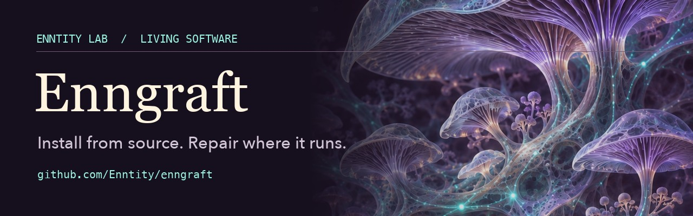

# Enngraft



Enngraft builds small command-line tools from source on the machine where they’ll run. If a build or check fails, a model you choose can propose a local repair. Enngraft stages the changes, runs the project’s checks again, and selects the passing build. The original source stays intact.

[Watch the Darkroom field trial](docs/field-trials/darkroom/README.md) · [Integration guide](docs/integration.md) · [Contribute](CONTRIBUTING.md) · [Security and privacy](SECURITY.md)

## Try it without a model

You’ll need Git and Python 3.9+. On macOS, install the Xcode Command Line Tools. For a Linux target, use Docker with a local toolchain image.

```sh
git clone https://github.com/Enntity/enngraft.git
cd enngraft
python3 -m venv .venv
source .venv/bin/activate
python -m pip install .
enngraft examples/hello --repairs 0
```

For a Docker target, run `docker pull node:22` first and add `--image node:22` to the last command. Use the printed `Run:` command with `Enngraft`. The program should print `Hello, Enngraft!`.

## Use it with your project

From a trusted project directory, run `enngraft .`. Enngraft recognizes common CLI layouts from source and build metadata. Give it a worked example in your README with the command and expected output. Ship an optional [manifest](examples/manifests/hoststamp.json) when you want to specify the source files, build, and acceptance checks yourself.

To enable model-assisted discovery and repair, set the full request URL and model ID:

```sh
export GRAFT_ENDPOINT="https://your-model-host.example/v1/chat/completions"
export GRAFT_MODEL="your-model-id"
# Set GRAFT_API_KEY through your secret manager if the endpoint requires it.
enngraft .
```

The default protocol is OpenAI-compatible. Use `GRAFT_PROTOCOL=messages` for Anthropic-compatible endpoints or `gemini` for Gemini. Model calls can include selected source files, build or check output, and target facts. Use `--repairs 0` for a model-free run. See [what leaves your machine](SECURITY.md#data-handling) before connecting a remote provider.

The [integration guide](docs/integration.md) covers supported layouts, the Docker toolchain, install receipts, and rollback. Enngraft targets small relocatable CLI projects with dependencies already present in the toolchain.

## Living Software

Living Software ships the source, operating knowledge, and checks needed to repair or adapt an application where it runs. The owner chooses the agent and controls how changes are applied. Enngraft applies that idea at installation time. Its local release history keeps the repair and receipt together and gives you a previous build to roll back to when one exists.

In the [Darkroom trial](docs/field-trials/darkroom/README.md), Enngraft repaired an x86-only photo tool separately on ARM macOS and ARM Linux. Both builds produced the same print as the original x86 build. The [QOA trial](docs/field-trials/qoa/README.md) follows a real upstream audio converter through installation and use.

## Contribute

Open an [issue](https://github.com/Enntity/enngraft/issues/new/choose) with a small reproducer or send a focused pull request. See the [contribution guide](CONTRIBUTING.md) for the checks and evidence to include.

The code is [MIT licensed](LICENSE). See [media credits](NOTICE.md) for artwork and demo assets.
